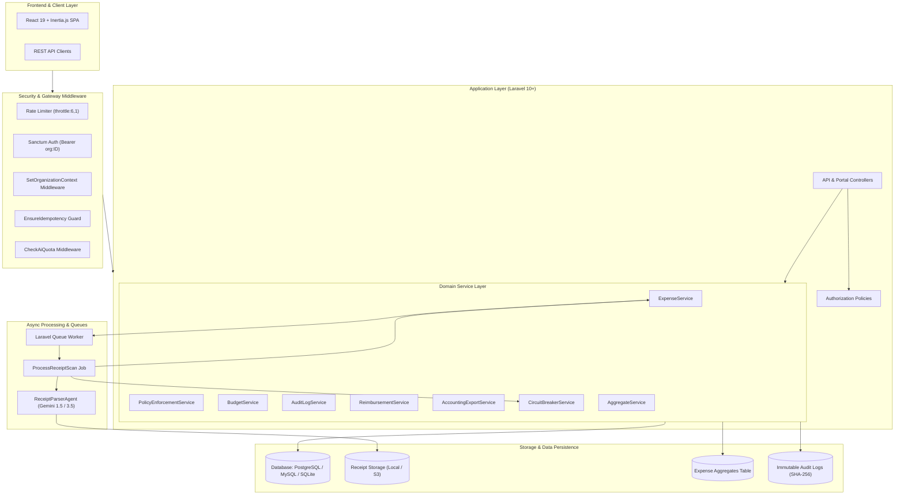
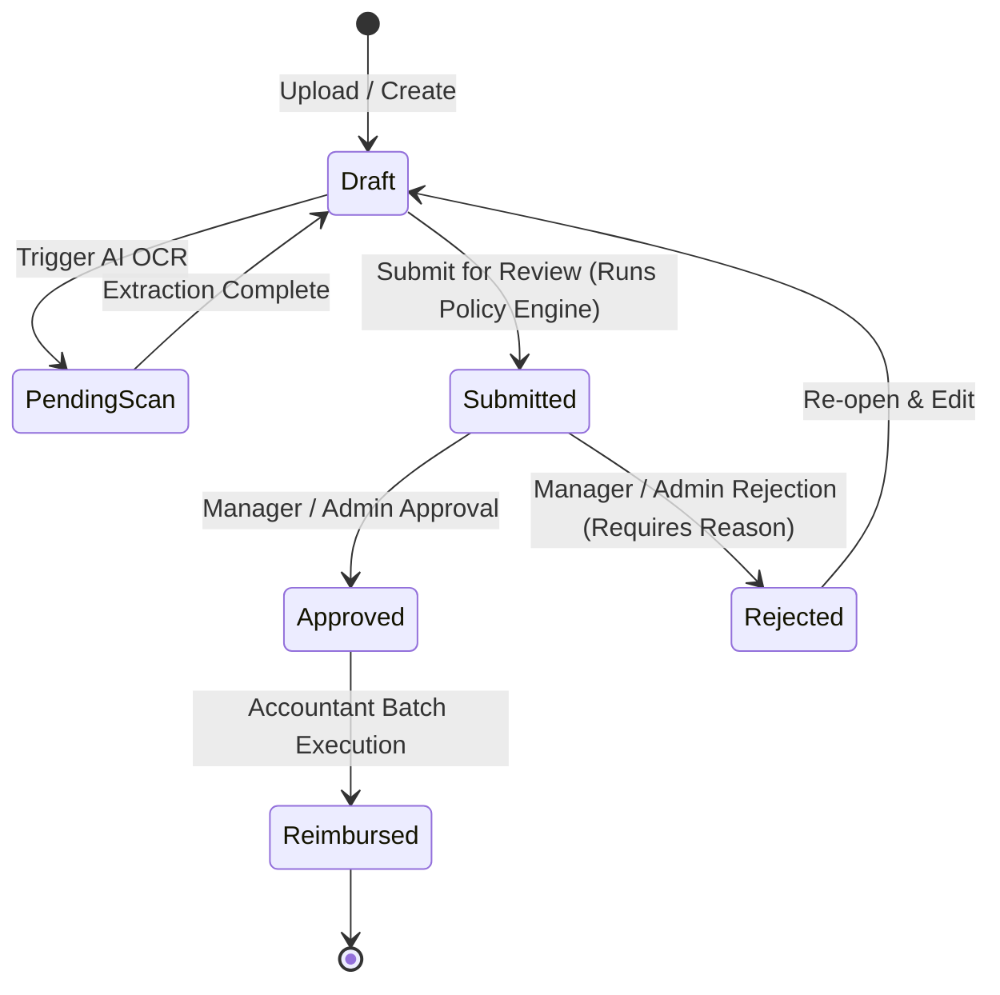

# 🧾 ReceiptSnap

> **Enterprise-Grade, Multi-Tenant Expense Management & AI-Powered Receipt Capture Platform**

ReceiptSnap is a modern, API-first expense management platform built with **Laravel 10+**, **React 19**, **Inertia.js**, and **Laravel AI**. It streamlines organizational expense workflows from initial receipt capture and optical character recognition (OCR) to managerial approvals, automated policy enforcement, batch payouts, and ERP accounting exports.

---

## 📑 Table of Contents

- [Key Features](#-key-features)
- [System Architecture](#-system-architecture)
- [Tech Stack](#-tech-stack)
- [Role-Based Portals](#-role-based-portals)
- [Installation & Getting Started](#-installation--getting-started)
- [Environment Configuration](#-environment-configuration)
- [Automated Policy Engine & Budget Controls](#-automated-policy-engine--budget-controls)
- [AI Receipt Extraction Pipeline](#-ai-receipt-extraction-pipeline)
- [Accounting & ERP Integrations](#-accounting--erp-integrations)
- [API Overview](#-api-overview)
- [Testing & Quality Assurance](#-testing--quality-assurance)
- [Documentation & Links](#-documentation--links)

---

## 🌟 Key Features

- **🤖 AI-Powered Receipt OCR & Itemization**: Automated extraction of merchant, date, amounts, taxes, tips, payment methods, and full itemized line items via Google Gemini Vision or OpenAI models.
- **🏢 Strict Multi-Tenancy**: Organization-scoped data boundaries backed by Laravel Sanctum token ability scoping (`org:{id}`) and global query scoping.
- **👥 Role-Based Portals**: Dedicated workspaces tailored for Employees, Managers, Accountants, and Administrators.
- **🛡️ Automated Compliance Engine**: Real-time policy violation checks (`MISSING_RECEIPT`, `WEEKEND_TRANSACTION`, `BUDGET_EXCEEDED`, and `DUPLICATE_RECEIPT` via perceptual image hashing).
- **💳 Reimbursement Batches & Bank Files**: Batch payout processing with automated file generation for **NACHA (US ACH)**, **SEPA XML**, and **CSV**.
- **📑 ERP & Accounting Exports**: Native export formatters for **QuickBooks Online/Desktop (IIF)**, **Xero**, **NetSuite**, **SAP**, and **Tax Ledgers**.
- **🔒 Tamper-Evident Audit Trail**: SHA-256 checksummed immutable audit logs recording every state transition, actor, IP address, and payload diff.
- **⚡ Pre-computed Aggregates**: Real-time rollup caching table eliminating heavy database aggregate scans on dashboard analytics.

---

## 🏛️ System Architecture



### Expense Lifecycle State Machine



---

## 🛠️ Tech Stack

### Backend
- **PHP 8.3+** with strict typing (`declare(strict_types=1);`)
- **Laravel 10+ / 11+** Framework
- **Laravel Sanctum** (Token Ability Scoping) & **Laravel Fortify** (Authentication, 2FA, Passkeys)
- **Laravel AI** (`laravel/ai`) with Google Gemini Vision & OpenAI drivers
- **Database**: PostgreSQL / MySQL / SQLite

### Frontend
- **TypeScript** & **React 19**
- **Inertia.js v3** (`@inertiajs/react`)
- **Tailwind CSS v4** (`@tailwindcss/vite`)
- **Lucide React** (Icons) & **Motion** (Framer Motion v12 Animations)
- **Vite 8** & **Bun** package manager

### Testing & Code Quality
- **Pest PHP 4** & PHPUnit test runners
- **PHPStan / Larastan** (Strict static analysis)
- **Laravel Pint** (Code style enforcement)

---

## 🖥️ Role-Based Portals

| Portal | Audience | Key Capabilities |
|---|---|---|
| **Employee Portal** | All Members | Drag-and-drop receipt scanning, draft itemization, submission, claim status tracker. |
| **Manager Portal** | Team Leads / Managers | Pending approval queue, policy violation warnings, instant approval/rejection with mandatory notes. |
| **Admin Console** | Owners / Admins | Department & category budget ceilings, member permissions, organization invitation lifecycles, global settings. |
| **Accountant Portal** | Finance / Accountants | Approved claims queue, reimbursement batch payouts, bank file generators (NACHA/SEPA), ERP exports, GL mapping, compliance packages. |

---

## 🚀 Installation & Getting Started

### 1. Prerequisites
- **PHP 8.3+** with extensions: `pdo`, `mbstring`, `openssl`, `gd` or `imagick`, `zip`
- **Composer 2.x**
- **Bun** (or Node.js 20+)
- **PostgreSQL / MySQL / SQLite**

### 2. Clone Repository
```bash
git clone https://github.com/bkallash/reciept-snap.git
cd reciept-snap
```

### 3. Install Dependencies
```bash
# Install PHP dependencies
composer install

# Install Frontend dependencies
bun install
```

### 4. Environment & Database Setup
```bash
# Create local environment configuration
cp .env.example .env

# Generate application encryption key
php artisan key:generate

# Run database migrations and seeders
php artisan migrate --seed

# Link public storage disk
php artisan storage:link
```

### 5. Start Development Servers
Run the full development stack (Web server, queue worker, and Vite hot-reloading) using the automated concurrently script:

```bash
composer run dev
```

Or start them individually:
```bash
# Terminal 1: Laravel Server
php artisan serve

# Terminal 2: Queue Worker
php artisan queue:listen --tries=1

# Terminal 3: Vite Dev Server
bun run dev
```

---

## ⚙️ Environment Configuration

Primary application settings are configured in `config/receipt-snap.php` and driven by `.env`:

| Variable | Default | Description |
|---|---|---|
| `RECEIPT_STORAGE_DISK` | `local` | Storage disk for receipt files (`local`, `s3`, `public`) |
| `RECEIPT_DEFAULT_CURRENCY` | `USD` | Default 3-letter ISO reporting currency |
| `RECEIPT_AI_PROVIDER` | `gemini` | AI OCR driver (`gemini`, `openai`) |
| `RECEIPT_AI_MODEL` | `gemini-3.5-flash-lite` | Vision model identifier |
| `GEMINI_API_KEY` | `null` | Google AI Gemini API credentials |
| `RECEIPT_REQUIRE_THRESHOLD` | `25.00` | Minimum expense amount requiring receipt attachment |
| `RECEIPT_FLAG_WEEKENDS` | `true` | Automatically flag non-business day transactions |
| `RECEIPT_STRICT_BUDGET` | `false` | If `true`, blocks submissions exceeding budget caps |

---

## 🛡️ Automated Policy Engine & Budget Controls

Every expense submitted to ReceiptSnap is evaluated against active policy rules:

1. **`MISSING_RECEIPT`**: Triggered when `amount` > `$25.00` (or `RECEIPT_REQUIRE_THRESHOLD`) without an attached receipt image.
2. **`WEEKEND_TRANSACTION`**: Triggered when `expense_date` falls on a Saturday or Sunday.
3. **`BUDGET_EXCEEDED`**: Triggered if the expense exceeds the assigned Department or Category budget threshold within the active period (`Monthly`, `Quarterly`, `Annual`).
4. **`DUPLICATE_RECEIPT`**: Triggered if identical merchant and amount occur within a 30-day window.
5. **`DUPLICATE_RECEIPT_IMAGE`**: Triggered if image perceptual hash distance (Hamming distance) $\le 10$ against any previously uploaded receipt.

---

## 🤖 AI Receipt Extraction Pipeline

1. **Upload**: User uploads receipt image via the web portal or API endpoint `POST /api/v1/expenses/{id}/scan`.
2. **Rate Limit & Quota Check**: Evaluates organization scan quota via `CheckAiQuota` middleware.
3. **Circuit Breaker Protection**: `CircuitBreakerService` stops outbound requests during upstream service degradation after 5 consecutive failures.
4. **Queue Processing**: `ProcessReceiptScan` executes in the background, extracts structured JSON fields via `ReceiptParserAgent`, and populates the expense record and line items.

---

## 📑 Accounting & ERP Integrations

The Accountant Portal provides seamless export capabilities for standard accounting platforms:

- **NACHA Payout Files**: Standard US ACH bank payment format for direct employee reimbursement.
- **SEPA XML**: ISO 20022 direct credit transfer files for European financial institutions.
- **QuickBooks**: Export formatted CSV or desktop IIF files mapped directly to chart-of-accounts GL codes.
- **Xero**: Payables Bill CSV import files.
- **NetSuite / SAP**: Journal Entry CSV exports.
- **Compliance Archive**: Complete ZIP bundle containing the SHA-256 audit log CSV and receipt image files.

---

## 📡 API Overview

ReceiptSnap features a comprehensive REST API v1.

| Method | Endpoint | Description |
|---|---|---|
| `POST` | `/api/v1/auth/register` | Register new user & organization |
| `POST` | `/api/v1/auth/login` | Authenticate and obtain Sanctum Bearer token |
| `POST` | `/api/v1/auth/switch-organization/{id}` | Switch active organization token scope |
| `GET` | `/api/v1/expenses` | List tenant-scoped expenses (with filters) |
| `POST` | `/api/v1/expenses` | Create new expense draft |
| `POST` | `/api/v1/expenses/{id}/scan` | Upload receipt image and trigger AI OCR |
| `POST` | `/api/v1/expenses/{id}/submit` | Submit expense and run policy engine |
| `POST` | `/api/v1/expenses/{id}/approve` | Manager/Admin approve expense |
| `POST` | `/api/v1/expenses/{id}/reject` | Manager/Admin reject expense with reason |
| `GET` | `/api/v1/departments/{id}/budget-status` | Get department budget utilization |
| `GET` | `/api/v1/categories/{id}/budget-status` | Get category budget utilization |
| `POST` | `/api/v1/reimbursement-batches` | Create payout batch for approved claims |
| `POST` | `/api/v1/reimbursement-batches/{id}/execute` | Mark batch executed & reimburse claims |
| `GET` | `/api/v1/accountant/export-erp` | Export expenses for QuickBooks/Xero/NetSuite |
| `GET` | `/api/v1/accountant/download-compliance-package` | Download ZIP compliance audit package |
| `GET` | `/api/v1/audit-logs` | Retrieve tamper-evident SHA-256 audit log trail |

*For complete request/response schemas, refer to [API_DOCUMENTATION.md](file:///D:/code%20Projects/Laravel/receipt-snap/API_DOCUMENTATION.md) and [DEVELOPER_GUIDE.md](file:///D:/code%20Projects/Laravel/receipt-snap/DEVELOPER_GUIDE.md).*

---

## 🧪 Testing & Quality Assurance

ReceiptSnap maintains automated test coverage across API, authentication, multi-tenancy, and policy enforcement layers.

```bash
# Run full Pest and PHPUnit test suite
php artisan test

# Run API-specific test suites
php artisan test --filter=Api

# Run code style fixer (Laravel Pint)
vendor/bin/pint

# Run static analysis (PHPStan / Larastan)
vendor/bin/phpstan analyse
```

---

## 📚 Documentation & Links

- **Developer Architecture Guide**: [DEVELOPER_GUIDE.md](file:///D:/code%20Projects/Laravel/receipt-snap/DEVELOPER_GUIDE.md)
- **REST API Reference**: [API_DOCUMENTATION.md](file:///D:/code%20Projects/Laravel/receipt-snap/API_DOCUMENTATION.md)
- **Repository**: [https://github.com/bkallash/reciept-snap](https://github.com/bkallash/reciept-snap)

---

## 📄 License

This project is open-sourced software licensed under the [MIT license](https://opensource.org/licenses/MIT).
