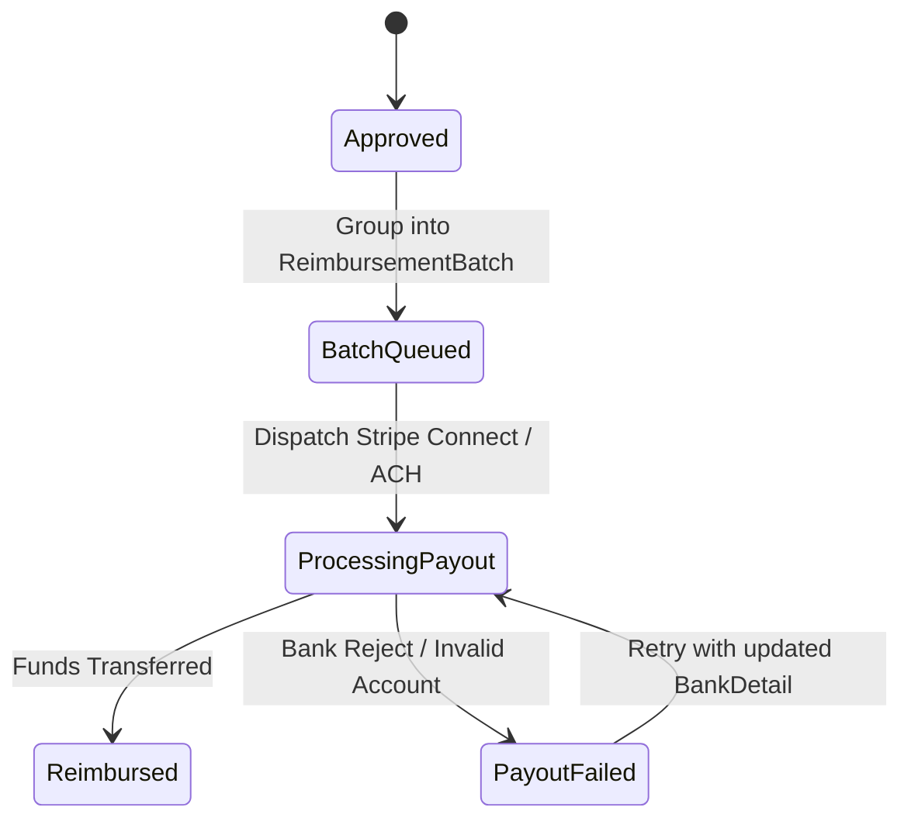

# 🧾 ReceiptFlow — AI-Powered Employee Expense & Receipt Tracker

## The Problem
Employees pay out-of-pocket for company expenses → submit paper/photo receipts → managers manually review → finance manually processes reimbursement. It's slow, error-prone, and frustrating for everyone.

## The Vision
A SaaS platform where employees snap a photo of a receipt, AI extracts all details instantly, managers approve with one click, and reimbursement flows automatically.

---

## 🏗️ Core Architecture & Multi-Tenancy Strategy

### Multi-Tenant Model: Hybrid Scoping
To balance operational cost with enterprise compliance requirements, ReceiptFlow employs a **Hybrid Multi-Tenancy Architecture**:
- **Standard (Free & Pro Tiers)**: Single database with row-level tenant isolation (`organization_id` column on all models). Enforced globally via Eloquent Global Scopes and tenant-aware middleware (`ScopeOrganization`).
- **Enterprise Tier**: Dedicated Database per tenant (or schema-per-tenant on Postgres) using Laravel Tenancy (`stancl/tenancy`). Provides complete data isolation, custom encryption keys, and independent backup/restore cycles required for SOC 2 / HIPAA compliance.

### Multi-Tenant Service Isolation Summary
| Subsystem | Free / Pro Tier Strategy | Enterprise Tier Strategy |
|-----------|--------------------------|--------------------------|
| **Database** | Shared DB + `organization_id` row scoping | Dedicated database / connection string |
| **File Storage** | Shared S3/R2 bucket (`/org_{id}/expenses/...`) | Isolated S3 bucket with customer-managed keys (KMS) |
| **Meilisearch** | Shared index (`receipts_v1`) with mandatory `organization_id` filter | Dedicated index per tenant (`org_{id}_receipts`) |
| **Redis Queues** | Shared Horizon queues with per-tenant rate throttling | Dedicated high-priority queue isolation (`queue:enterprise_{id}`) |

### Idempotency & Concurrency Guarantees
To prevent duplicate processing, double reimbursement, or double-approval from retried webhooks or user double-clicking:
- **API Idempotency Header**: All state-mutating requests (`POST /api/v1/expenses`, `/approve`, `/payouts`) accept an `X-Idempotency-Key` header (or auto-generated hash from user + file payload).
- **Atomic Execution**: Key check enforced via Redis atomic locks (`Cache::lock("idempotency:{key}", 60)`).
- **Idempotency Record**: Key stored in `idempotency_keys` table alongside the response payload. Resubmitting an identical key returns the cached response with an `X-Cache: Idempotent-Hit` header without re-executing logic or AI calls.

---

## 🤖 AI Receipt Scanning & Resiliency

### Processing Pipeline
1. Employee uploads receipt photo / PDF (via PWA dropzone, email forwarding, or WhatsApp bot).
2. Rate-limiting & file-validation check (Max 10MB; MIME validation for `image/jpeg`, `image/png`, `application/pdf`).
3. Quota check against monthly org limit.
4. Async Job dispatch to Horizon queue (`ProcessReceiptScan`).
5. AI Extraction (Google Cloud Vision OCR + Gemini structured parser).
6. Result written to `receipts` table with confidence score per field.
7. If confidence < 80%, flagged for manual user confirmation.

### AI Cost Controls & Quota Enforcement
- **Monthly Quota Caps**: Tracked per organization in Redis counter and DB (`organizations.ai_scans_used_this_month`). Standard Free: 50/mo, Pro: Unlimited (subject to fair-use rate limits).
- **Quota Exceeded Action**: Endpoint returns `429 Too Many Requests` with payload indicating monthly quota exhaustion and upgrade CTA.
- **OCR Retry Limits**: Failed AI parsing jobs retry a maximum of 3 times with exponential backoff (`delay = 5 * (2 ^ attempt)`). Repeated failures drop to `FailedScan` queue to prevent runaway API billing.

### Fallback Circuit Breaker & Degraded Mode
- **Circuit Breaker Pattern**: If Google Cloud Vision or Gemini API fails 5 consecutive times or latencies exceed 10 seconds, circuit opens for 5 minutes (`Cache::put('circuit:ai_service', 'open', 300)`).
- **Degraded Mode ("Submit Now, AI-Extract Later")**:
  - When circuit is open, receipt uploads **do not fail or block the employee**.
  - Expense is saved in `PendingScan` state.
  - Basic details (amount, category) can be manually entered by employee immediately to start approval workflow.
  - Background worker periodically re-processes `PendingScan` queue once AI service health restores.

---

## 🛡️ Security, Compliance & Data Governance

### Encryption Key Management
- **Sensitive Financial Data**: Model `BankDetail` (routing & account numbers) is encrypted at rest using Laravel's `Crypt` facade (AES-256-GCM).
- **Enterprise Key Rotation**: Enterprise tenants can optionally bind AWS KMS or HashiCorp Vault per-tenant data encryption keys (DEKs).

### PCI & Financial Data Handling
- ReceiptFlow **does not store full Credit Card Primary Account Numbers (PANs)**.
- AI parser extracts and stores only `card_last_four` and `card_brand` for transaction matching.
- Bank payouts are executed strictly via tokenized bank accounts via Stripe Connect Financial Connections / Plaid.

### Immutable Audit Trail (`AuditLog`)
- Compliance-driven, append-only table `audit_logs` tracking every state transition and financial change.
- **Tracked Events**: Expense creation, field edits, approval, rejection, budget override, reimbursement payout, policy change.
- **Fields Recorded**: `organization_id`, `user_id`, `auditable_type`, `auditable_id`, `action`, `old_values` (JSON), `new_values` (JSON), `ip_address`, `user_agent`, `timestamp`.
- **Immutability**: Database user permissions prevent `UPDATE` or `DELETE` on `audit_logs`.

### Webhook Security
- All incoming webhooks (Stripe, QuickBooks, Slack) pass through signature verification middleware (`VerifyWebhookSignature`). Unsigned or invalid requests are dropped with `401 Unauthorized`.

### Soft Deletes & GDPR Data Retention
- All core financial records (`expenses`, `receipts`, `approval_steps`, `payouts`) use Laravel `SoftDeletes` (`deleted_at`). Hard deletion is prevented for compliance retention periods (7 years).
- **GDPR Export & Right-to-Erasure API**:
  - Data Export (`GET /api/v1/tenant/export`): Generates ZIP containing user JSON metadata + S3 receipt images.
  - Right-to-Erasure (`POST /api/v1/tenant/purge`): Anonymizes PII (user name, email, bank details) while preserving scrubbed financial totals for org tax/audit consistency.

---

## ⚡ Scalability & Performance Strategy

### File Storage, Image Compression & CDN
- **Upload Optimization**: Images uploaded via web/mobile undergo client-side image compression (Canvas/WebP) and server-side optimization (`Spatie/laravel-image-optimizer`).
- **Thumbnailing**: Server generates `200x200` WebP thumbnails and `800x800` WebP previews immediately upon upload.
- **CDN Acceleration**: Receipt images served through Cloudflare CDN with signed URLs (15-minute expiration) to protect private receipt images while providing instant browser loading for managers reviewing receipt streams.

### Search Architecture (Meilisearch)
- Integrated via Laravel Scout.
- **Multi-Tenant Index Strategy**:
  - Standard plan uses a shared index (`receipts`) with mandatory `filter: "organization_id = {org_id}"` configured in Scout's searchable parameters.
  - Enterprise uses tenant-isolated index (`org_{id}_receipts`).

### Queue Backpressure & Horizon Priority
- Queue architecture segmented in Laravel Horizon:
  1. `payouts` — Priority 1 (High availability)
  2. `ai-high` — Priority 2 (Pro/Enterprise scans)
  3. `ai-standard` — Priority 3 (Free tier scans)
  4. `notifications` — Priority 4 (Emails, webhooks)
- **Noisy Tenant Throttling**: Rate limiter per tenant (`Redis::throttle('queue:org:' . $orgId)->allow(50)->every(60)`). Over-quota scan jobs are delayed rather than dropped.

### Read-Heavy Dashboard Strategy
- Live computing of aggregate metrics (e.g. "Department spend this quarter") directly from normalized OLTP tables causes severe DB locks as data grows.
- **Pre-computed Aggregates**: Maintained in `daily_department_spends` and `monthly_user_spends` aggregate tables, updated asynchronously via domain event listeners (`ExpenseApproved`, `ExpenseReimbursed`).
- Analytics endpoints query these optimized aggregate tables or dedicated Read-Replicas.

---

## 💵 Reimbursement & Payout Flow Detail

### Reimbursement Workflow


### Models & Schema Architecture
- **`ReimbursementBatch`**: Represents a collection of approved expenses grouped by organization/department for payout execution (e.g., "Weekly Finance Payout #104").
- **`Payout`**: Tracks individual transfer attempt to an employee's `BankDetail`.
- **Currency Handling**:
  - `expense.currency`: Original scan currency (e.g., EUR 50.00).
  - `payout.currency`: Bank account currency (e.g., USD 54.20).
  - Exchange rate locked at payout creation time via exchange rate API and recorded on `payout.exchange_rate`.
- **Failure Recovery**: Failed transfers mark `Payout` as `Failed` with failure code (`insufficient_funds`, `invalid_routing_number`), leaving expenses in `BatchQueued` state so finance can correct details and retry without double-paying.

---

## 📐 Key Database Models & Schema Outline

```
Organization
├── has many → Users (with roles via pivot)
├── has many → Departments
├── has many → ExpenseCategories
├── has many → Policies
├── has many → AuditLogs (immutable)
├── has many → ReimbursementBatches
└── has one  → Subscription (billing)

User
├── belongs to → Organization
├── has many → Expenses
└── has one  → BankDetail (encrypted account/routing details)

Expense (SoftDeletes, Idempotent)
├── belongs to → User (submitter)
├── belongs to → ExpenseCategory
├── belongs to → Organization
├── has one  → Receipt (AI-extracted metadata)
├── has many → ReceiptImages (original + thumbnail WebP paths)
├── has many → LineItems
├── has many → ApprovalSteps
├── has many → Comments
└── belongs to → ReimbursementBatch (optional null until queued)

Receipt (AI Data)
├── belongs to → Expense
├── merchant_name, date, subtotal, tax, tip, total, currency
├── raw_ocr_text, confidence_score
└── has many → LineItems

ReimbursementBatch
├── belongs to → Organization
├── status: draft | queued | processing | completed | partial_failure
├── total_amount, currency
└── has many → Payouts

Payout
├── belongs to → ReimbursementBatch
├── belongs to → User
├── stripe_transfer_id, status (pending|succeeded|failed)
├── source_currency, target_currency, exchange_rate
└── amount

AuditLog (Immutable, no update/delete)
├── organization_id, user_id, auditable_type, auditable_id
├── action, old_values, new_values, ip_address, created_at
```

---

## 📱 Employee & Manager Dashboards

### Employee Experience
- **Quick Submit**: Drag-and-drop or camera capture (PWA).
- **Status Badges**: `Draft` → `PendingScan` → `Submitted` → `Approved` → `Reimbursed`.
- **Real-Time Feed**: Pusher / Reverb live notification when expense is approved or payout initiated.

### Manager Experience
- **One-Click Approval Queue**: Quick review with side-by-side receipt image & AI line-item verification.
- **Policy Flag Badges**: Automatic warnings ("Exceeds $50 limit", "Weekend purchase", "Duplicate detected").
- **Bulk Actions**: Select multiple expenses → Approve with digital audit log signature.

---

## 💰 Monetization & Feature Matrix

| Feature | Free | Pro ($8/user/mo) | Enterprise (Custom) |
|---------|------|-------------------|---------------------|
| Users | Up to 5 | Unlimited | Unlimited |
| AI Scans/month | 50 | Unlimited (fair use) | Dedicated AI quota |
| Storage & Retention | 1 GB (3 yrs) | 50 GB (7 yrs) | Custom / Unlimited |
| Multi-Tenancy Architecture | Shared Schema | Shared Schema | Dedicated DB per tenant |
| Audit Trail | 30 days | 7 years | Unlimited (exportable) |
| Custom Encryption Keys | — | — | ✅ (AWS KMS / Vault) |
| Approval Workflows | Basic (1 level) | Multi-level | Custom chains & delegate |
| Integrations | — | QuickBooks, Xero | SAP, Oracle, Custom |
| API Access & Webhooks | — | — | ✅ |
| Dedicated Queue Priority | Standard | Priority | Dedicated Enterprise Queue |

---

## 🚀 Implementation Roadmap (API-First Strategy)

> [!NOTE]  
> **Development Approach**: We follow an **API-First methodology**. Core domain models, multi-tenant database schema, Sanctum security, AI pipeline, audit logging, and RESTful API endpoints are built and validated with Pest tests in Phases 1–3 before frontend UI components are created in Phase 4.

### Phase 1 — Backend Core, Multi-Tenant Architecture & Security (Weeks 1–3)
- [ ] Database migrations & schema setup (`organizations`, `users`, `expenses`, `receipts`, `line_items`, `categories`, `policies`, `approval_steps`, `audit_logs`, `idempotency_keys`) with `SoftDeletes`.
- [ ] Hybrid Multi-tenancy setup (Tenant scoping middleware `ScopeOrganization`, Eloquent global scopes, Enterprise database connection switcher).
- [ ] Authentication & API Security (Laravel Sanctum API tokens, Fortify, RBAC gates & policies).
- [ ] Envelope Encryption setup for sensitive user data (`BankDetail`).
- [ ] Rate Limiting & Abuse Prevention middleware (Per-org/per-IP rate limits for public receipt endpoints & email/whatsapp ingest).
- [ ] Core REST API endpoints with API Resources & Form Requests (`/api/v1/organizations`, `/api/v1/users`, `/api/v1/categories`, `/api/v1/expenses`).
- [ ] Pest API feature tests for all core endpoints (100% route coverage).

### Phase 2 — Receipt Capture, AI Extraction Pipeline, Idempotency & Resiliency (Weeks 4–5)
- [ ] File storage service (S3/Cloudflare R2 integration, WebP compression, thumbnail generator, CDN signed URLs).
- [ ] Idempotency middleware (`X-Idempotency-Key` atomic Redis lock + response cache).
- [ ] AI Quota Enforcement middleware & organization monthly scan usage tracker.
- [ ] Asynchronous Horizon queue pipeline (`ProcessReceiptScan` job on prioritized `ai-high` / `ai-standard` queues with tenant throttles).
- [ ] AI OCR & Extraction Service (Google Cloud Vision / Gemini parser interface & mockable service wrapper).
- [ ] AI Circuit Breaker & Degraded Mode logic (`PendingScan` fallback state when AI APIs fail or timeout).
- [ ] Line-item auto-extraction, confidence scoring & duplicate detection engine.
- [ ] Contract tests for Google Cloud Vision / Gemini API responses against mock JSON snapshots.

### Phase 3 — Business Logic, Reimbursements, Audit Logging & Integrations (Weeks 6–7)
- [ ] Approval workflow engine & multi-level delegation endpoints (`/api/v1/expenses/{id}/approve`, `reject`, `delegate`).
- [ ] Immutable `AuditLog` event recorder & listeners (`ExpenseApproved`, `ExpenseReimbursed`, `PolicyUpdated`).
- [ ] Policy engine (spending limits, category rules, policy violation flagging, auto-approval rules).
- [ ] Reimbursement Batch & Payout engine (`ReimbursementBatch`, `Payout` models, multi-currency conversion, Stripe Connect payout handlers).
- [ ] Pre-computed aggregate tables (`daily_department_spends`, `monthly_user_spends`) updated via domain event listeners.
- [ ] Webhook signature verification middleware (`VerifyWebhookSignature` for Stripe, QuickBooks, Slack).
- [ ] GDPR Right-to-Erasure & Data Export API (`/api/v1/tenant/export`, `/api/v1/tenant/purge`).

### Phase 4 — Frontend UI & User Experience (Weeks 8–10)
- [ ] Base layout & design system (Livewire 3 + Flux UI components, Tailwind typography & dark mode).
- [ ] Employee Portal UI (receipt photo/PDF dropzone, AI extraction review card, expense history, status badge stream).
- [ ] Manager Dashboard UI (approval queue, line item breakdown modal, team spending aggregate charts).
- [ ] Organization Admin UI (policy editor, department budget manager, member management, audit log viewer).
- [ ] Mobile PWA optimization (camera capture flow, PWA manifest, offline queue state).

### Phase 5 — Testing, AI Load Testing & Sandbox Verification (Weeks 11–12)
- [ ] Stripe Connect & Plaid Sandbox staging environment setup for simulated ACH/payout testing.
- [ ] Horizon queue backpressure & load testing (simulating thousands of concurrent receipt uploads across noisy tenants).
- [ ] Multi-tenant isolation penetration/security testing (verifying zero cross-tenant data leakages under edge cases).
- [ ] End-to-end Pest & Playwright integration testing.

---

## 🎯 Next Steps

1. **Approve Updated Architecture & Roadmap** — Confirm hybrid multi-tenancy model, AI circuit breaker, idempotency design, and updated phase breakdown.
2. **Setup Data Schema & Migrations** — Run migrations for Organizations, Users, Expenses, AuditLogs, Payouts, and encrypted BankDetails.
3. **Build Core REST API & Sanctum Auth** — Implement multi-tenant routes, Sanctum tokens, and rate-limiting middleware.
4. **Implement AI Queue & Circuit Breaker** — Build `ProcessReceiptScan` job with Gemini fallback and contract tests.
5. **Develop Frontend UI (Phase 4)** — Connect Livewire 3 / Flux UI components to tested backend APIs.
